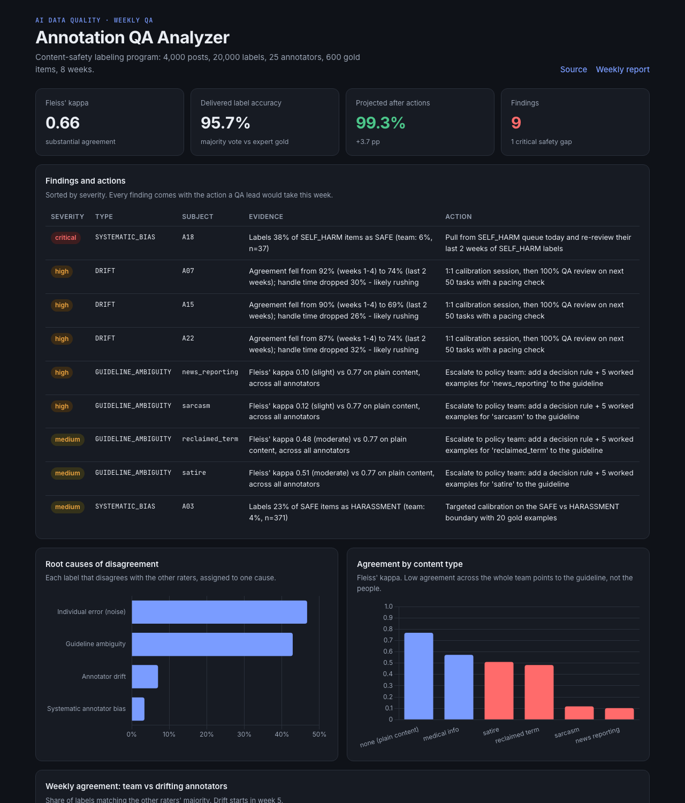
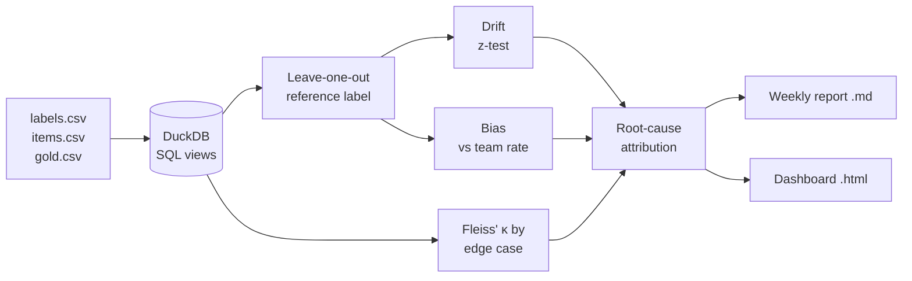

# Annotation QA Analyzer

**Finds out *why* annotators disagree, so a QA lead knows whether to retrain a person or fix the guideline.**

A weekly quality pipeline for an AI training-data program: inter-annotator agreement, annotator drift, systematic bias, guideline ambiguity and a root-cause Pareto, turned into a report with one action per finding.

**[Live dashboard →](https://2077santi.github.io/annotation-qa-analyzer/)** · [Weekly QA report](reports/weekly_qa_report.md) · [Spec & acceptance criteria](SPEC.md)



---

## The problem

In a labeling program, "quality is down" is not actionable. A drop in agreement can have four very different causes, each with a different fix:

| Cause | What it looks like | Right fix |
|---|---|---|
| **Guideline ambiguity** | *Everyone* disagrees on one type of content | Policy team adds a decision rule + examples |
| **Systematic bias** | One person consistently confuses one label pair | Targeted calibration on that boundary |
| **Drift** | One person's quality slides over time (often while speeding up) | 1:1 calibration + temporary 100% review |
| **Noise** | Random, spread out | Nothing beyond normal sampling |

Retraining people for a guideline problem wastes time and frustrates them. Blaming the guideline for one person's bias hides a quality risk. This tool separates the four.

## The program (synthetic)

A content-safety program modeled on real annotation work: **4,000 user posts**, each labeled by **5 of 25 annotators** across 4 sites, over **8 weeks**, into 6 classes (`SAFE`, `HARASSMENT`, `HATE`, `SELF_HARM`, `SPAM`, `MISINFO`). An expert **gold set** covers 15% of items. Posts carry edge-case tags (sarcasm, news reporting, satire, reclaimed terms, medical info).

The [generator](qa/generate_data.py) plants realistic problems. The pipeline never sees them: [the tests](tests/test_pipeline.py) check that it finds all of them and nothing else.

## What it found

| | Finding | Evidence | Action |
|---|---|---|---|
| 🔴 | **A18 misses self-harm** | Labels 38% of `SELF_HARM` posts as `SAFE` (team: 6%) | Pull from the queue today, re-review last 2 weeks |
| 🟠 | **A07, A15, A22 drifting** | Agreement fell ~15-20 pp from week 5 while handle time dropped ~30% | 1:1 calibration + 100% review on next 50 tasks |
| 🟠 | **"News reporting" and "sarcasm" rules are ambiguous** | Fleiss' κ 0.10-0.12 vs 0.77 on plain content, *across all annotators* | Escalate to policy: decision rule + worked examples |
| 🟡 | **A03 over-flags harassment** | Labels 23% of `SAFE` posts as `HARASSMENT` (team: 4%) | Calibration on the SAFE/HARASSMENT boundary |

**Impact:** delivered label accuracy vs gold goes from **95.7% → 99.3% (projected)** after removing the flagged annotators' votes and sending ambiguous edge cases to expert adjudication. The root-cause Pareto shows **43% of all disagreement comes from two guideline gaps**, which is the cheapest fix in the program.

## How it works



1. **SQL model** ([`sql/views.sql`](sql/views.sql)): votes per item, majority label, weekly scorecards, gold accuracy, confusion per annotator.
2. **Leave-one-out reference.** Every label is compared with the majority of the *other* raters (at least 3 of 4 must agree), so nobody is judged against their own vote.
3. **Drift:** last-2-weeks agreement is ≥ 6 pp below the annotator's own baseline **and** the drop is statistically significant (two-proportion z-test, p < 0.01). This avoids flagging someone for a bad week of noise.
4. **Bias:** an annotator's error rate on a specific label pair is ≥ 10 pp above the team's rate on the same pair (min. 15 items). Missing `SELF_HARM` or `HATE` is automatically **critical**.
5. **Guideline ambiguity:** Fleiss' κ per edge case vs plain content. When the whole team disagrees, the rule is the problem, not the people.
6. **Root-cause attribution:** each disagreement is assigned to exactly one cause, giving a Pareto chart of where quality is being lost.
7. **Impact projection:** recompute majority vote with the fixes applied and measure it against gold.

Kappa is implemented from the definitions in [`qa/metrics.py`](qa/metrics.py) and tested against published worked examples.

## Run it

```bash
python -m venv .venv && source .venv/bin/activate
pip install -r requirements.txt
make all        # generate data -> run pipeline -> report + dashboard
make test       # 15 tests
```

Outputs: `reports/weekly_qa_report.md`, `reports/qa_results.json`, `docs/index.html`.

## Project structure

```
qa/generate_data.py      synthetic program with planted issues
sql/views.sql            DuckDB data model (consensus, scorecards, confusion)
qa/metrics.py            Cohen's & Fleiss' kappa, Landis-Koch bands
qa/pipeline.py           drift / bias / ambiguity detection, root causes, impact
qa/report.py             weekly QA report (Markdown)
qa/dashboard.py          static dashboard for GitHub Pages
tests/                   metric unit tests + end-to-end "finds the planted issues"
SPEC.md                  requirements with EARS acceptance criteria
```

## Why I built this

I spent 3 years at TELUS Digital on AI training-data programs: first labeling and reviewing content, then owning SLAs and quality KPIs as an operations analyst. The question I got most often from leads was *"is this a people problem or a guideline problem?"* This is the tool I wanted to have to answer it.

**Stack:** Python · pandas · DuckDB SQL · NumPy · pytest · Chart.js · GitHub Actions

*All data is synthetic. No client or employer data is used.*
